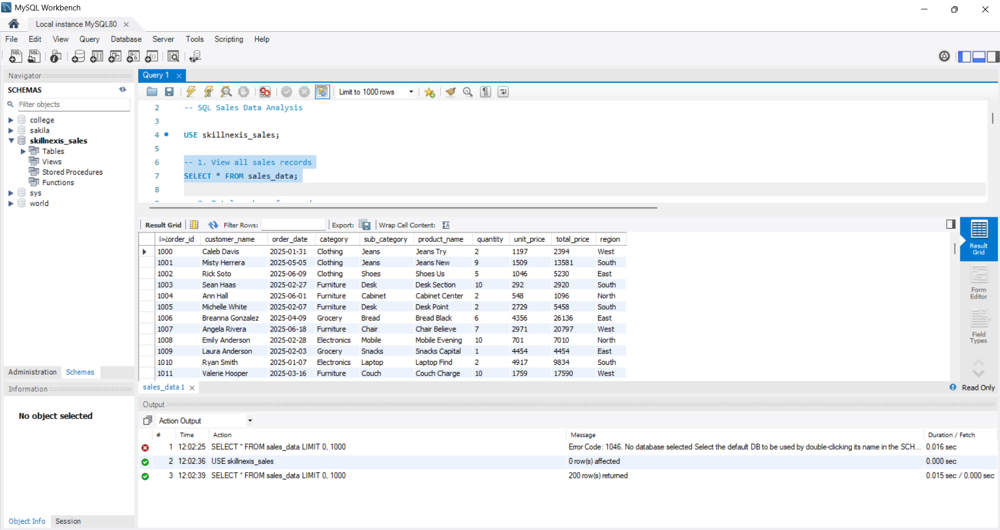
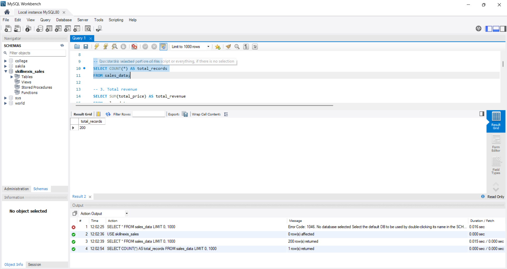
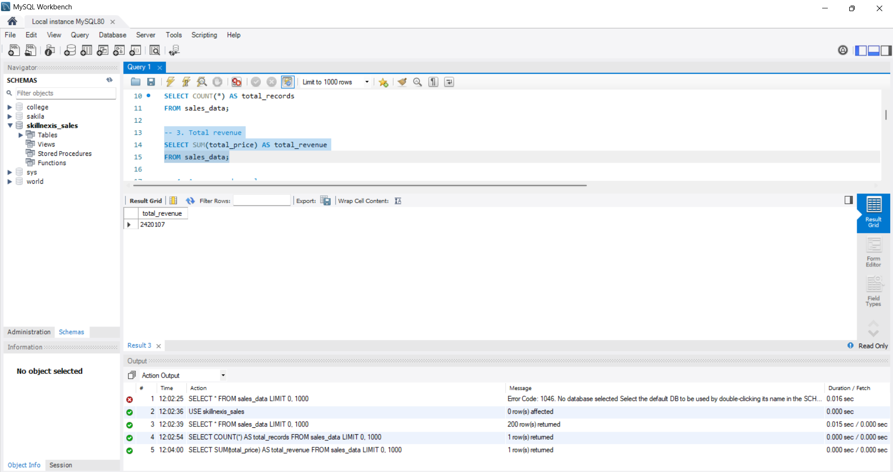
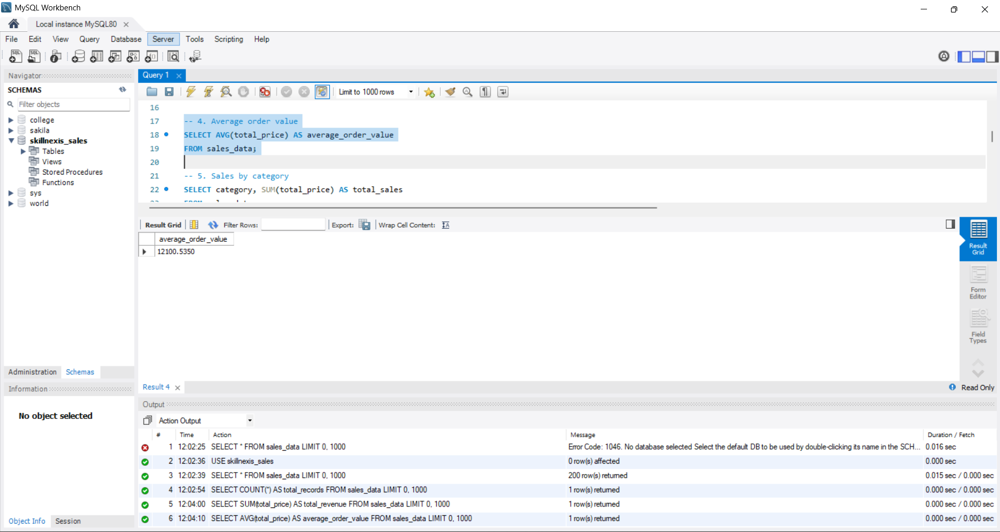
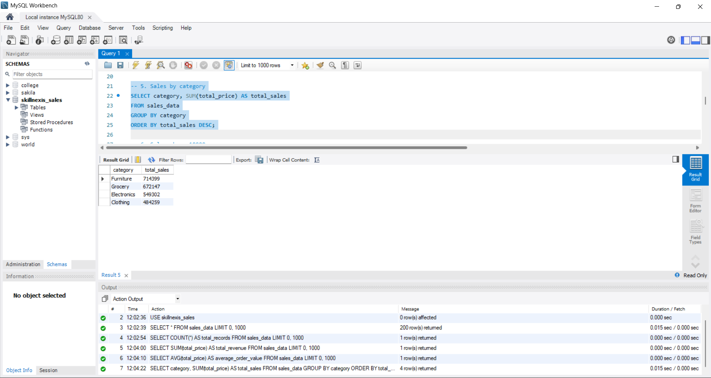
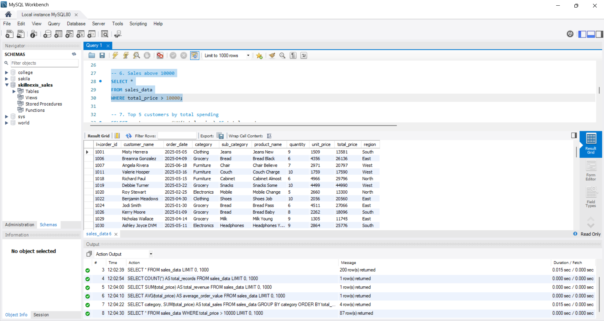
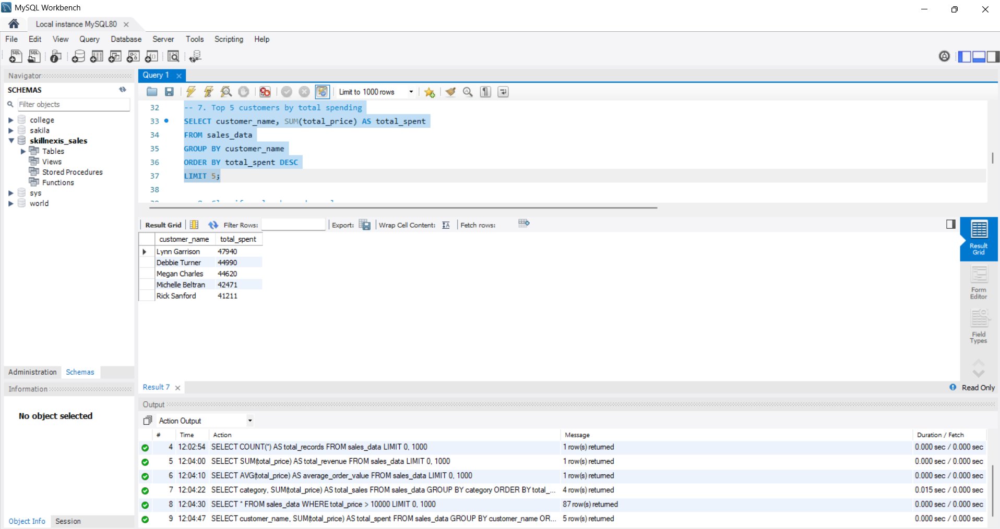
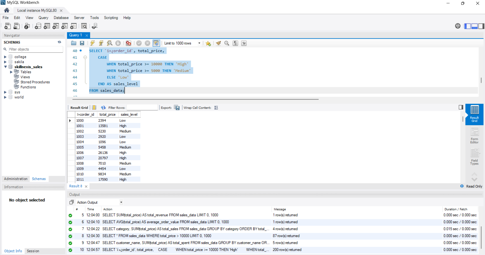
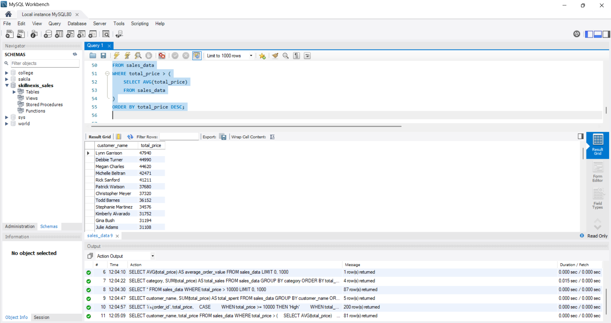

# SkillNexis Internship – Week 2 SQL Project

## Project Overview

This project analyzes sales data using SQL and MySQL Workbench to understand sales performance, customer spending, and order values.

## Dataset

The dataset contains 200 sales records with information about customers, products, order dates, categories, prices, quantities, and regions.

## Tools Used

* MySQL Workbench
* SQL
* Microsoft Excel

## SQL Concepts Used

* SELECT
* WHERE
* COUNT(), SUM(), AVG()
* GROUP BY
* ORDER BY
* LIMIT
* CASE statements
* Subqueries
* Sales analysis by category
* Top 5 customers by total spending
* Average order value analysis

## Key Insights

* Furniture generated the highest total sales.
* Grocery ranked second in total sales.
* Lynn Garrison was the top customer by total spending.

## Project Files

* `analysis.sql` – SQL queries used for the analysis.
* `SQL_Sales_Dataset_200_Rows.xlsx` – Original sales dataset.
* `README.md` – Project overview and documentation.

## 📸 SQL Query Results

### 1. All Sales Records

### 2. Total Records

### 3. Total Revenue

### 4. Average Order Value

### 5. Sales by Category

### 6. Sales Above 10000

### 7. Top 5 Customers

### 8. Sales Classification

### 9. Sales Above Average

## Conclusion

This project demonstrates the use of SQL queries to analyze sales data and identify useful business insights.
